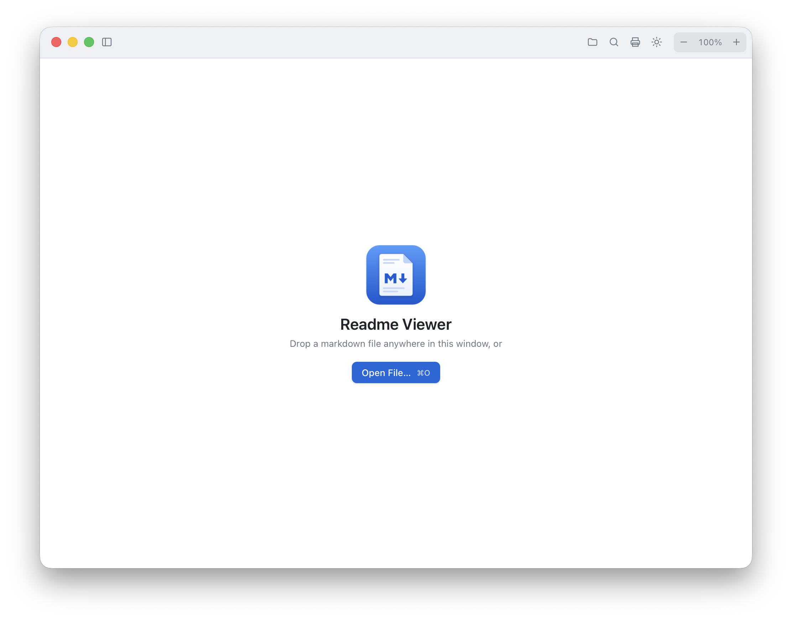
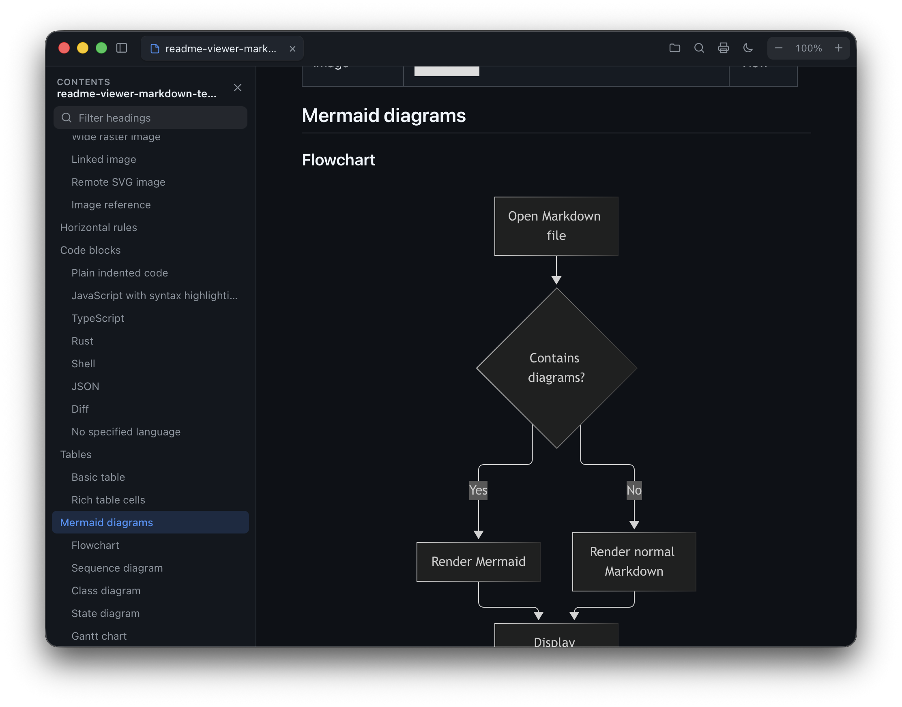

# Readme Viewer

A small, fast markdown viewer for macOS, Windows and Linux. It's built with Tauri, so the installer stays tiny and it opens pretty much instantly.

It's only a viewer. There's no editor, and that's realy on purpose.

I have to review a lot of markdown files but could not find something that suits my needs. Hopefully, this is helpful to someone.





## What it does

- Renders GitHub flavored markdown: tables, task lists, footnotes, alerts (`> [!NOTE]`), emoji shortcodes and raw HTML like `<details>` or centered images
- Mermaid diagrams, math with KaTeX and syntax highlighting for code blocks
- Reloads the file when it changes on disk and keeps your scroll position
- Tabs, multiple windows, and you can drag a tab to another window (or out of the window to give it it's own)
- Table of contents sidebar, find in page and a recent files list
- Light, dark or follow the system, plus zoom
- Can be set as the default app for `.md` files
- Updates itself

Everything is bundled with the app, so it works fully offline. The only network stuff is remote images inside a README (badges and so on) and the update check.

## Install

Grab the latest build from the [releases page](https://github.com/ykamal/readme-viewer/releases).

| OS | File |
|---|---|
| macOS (Apple Silicon, M1 and newer) | `Readme.Viewer_x.y.z_aarch64.dmg` |
| macOS (Intel) | `Readme.Viewer_x.y.z_x64.dmg` |
| Windows | `Readme.Viewer_x.y.z_x64-setup.exe` |
| Linux (any distro) | `Readme.Viewer_x.y.z_amd64.AppImage` |
| Debian, Ubuntu | `Readme.Viewer_x.y.z_amd64.deb` |
| Fedora, openSUSE | `Readme.Viewer-x.y.z-1.x86_64.rpm` |

You can ignore `latest.json`, the `.app.tar.gz` files and the `.sig` files, those are for the auto updater.

Auto updates work for the macOS, Windows and AppImage builds. If you installed the `.deb` or `.rpm`, just install the newer package when a release comes out.

### macOS

I don't want to pay Apple to notarize this app (really Apple?) so please follow the following instruction to run this:

1. Open the `.dmg` and drag **Readme Viewer** into **Applications**
2. Open Readme Viewer. macOS will say it can't verify the app. Click **Done**, not "Move to Trash"
3. Open **System Settings** and go to **Privacy & Security**
4. Scroll down to the Security section. You'll see a message about Readme Viewer being blocked, click **Open Anyway**
5. Confirm with your password or Touch ID, then click **Open Anyway** one more time

That's it, you only have to do this once. Updates installed from inside the app don't trigger the warning again.

If you're comfortable with the terminal, this does the same thing in one go:

```sh
xattr -dr com.apple.quarantine "/Applications/Readme Viewer.app"
```

### Windows

The installer isn't code signed either, so SmartScreen may show "Windows protected your PC". Click **More info** and then **Run anyway**.

### Linux

The AppImage needs to be made executable first:

```sh
chmod +x Readme.Viewer_*_amd64.AppImage
./Readme.Viewer_*_amd64.AppImage
```

The `.deb` and `.rpm` install like any other package.

### Making it the default for markdown files

The installer registers the app for `.md`, `.markdown`, `.mdown`, `.mkd` and `.mkdn` files, but your OS still wants you to confirm the default yourself. There's a "Set as Default Markdown App" item in the menu that walks you through it.

## Shortcuts

`Cmd` on macOS, `Ctrl` everywhere else.

| Action | Shortcut |
|---|---|
| Open file | `Cmd+O` |
| New window | `Cmd+Shift+N` |
| Close tab | `Cmd+W` |
| Find | `Cmd+F`, then `Enter` / `Shift+Enter` |
| Table of contents | `Cmd+Shift+L` |
| Zoom in / out / reset | `Cmd+=` / `Cmd+-` / `Cmd+0` |
| Reload | `Cmd+R` |
| Next / previous tab | `Ctrl+Tab` / `Ctrl+Shift+Tab` |

Right click a tab for "Move to New Window", "Close Other Tabs" and "Show in Folder".

## Development

You need [Node](https://nodejs.org) 20+, [pnpm](https://pnpm.io) and [Rust](https://rustup.rs). On Linux you also need the WebKitGTK packages, see the [Tauri prerequisites](https://v2.tauri.app/start/prerequisites/).

```sh
pnpm install
pnpm tauri dev
```

To open files right away in dev:

```sh
pnpm tauri dev -- -- /path/to/README.md
```

The frontend is plain TypeScript in `src/`, no framework. The Rust side in `src-tauri/src/` is pretty small and handles file reading, watching, windows, the menu and recent files.

## Releasing

Releases are built by GitHub Actions when you push a version tag.

1. Bump the version. Pass a version number or `patch`, `minor` or `major`:
   ```sh
   scripts/bump-version.sh patch
   ```
2. Commit and push, then tag the release:
   ```sh
   git commit -am "bump to 0.2.0"
   git push
   scripts/release-tag.sh
   ```
   The tag script reads the version from `package.json`, refuses to run if that tag already exists, and pushes the new tag.
3. The workflow creates a draft release with all the installers. Publish it and everyone will recieve the update.

### One time setup for updates

Updates have to be signed, otherwise the app won't install them. Generate a key pair once:

```sh
pnpm tauri signer generate -w ~/.tauri/readme-viewer.key
```

- Put the contents of `~/.tauri/readme-viewer.key.pub` in `plugins.updater.pubkey` in `src-tauri/tauri.conf.json`
- Add these repo secrets on GitHub: `TAURI_SIGNING_PRIVATE_KEY` (contents of the private key file) and `TAURI_SIGNING_PRIVATE_KEY_PASSWORD`
- Back up the private key somewhere safe. If you loose it, existing installs can never update again.

### Code signing (optional)

The workflow is already set up for macOS signing and notarization. It turns on by itself once these secrets exist: `APPLE_CERTIFICATE`, `APPLE_CERTIFICATE_PASSWORD`, `APPLE_SIGNING_IDENTITY`, `APPLE_ID`, `APPLE_PASSWORD` and `APPLE_TEAM_ID`. See the [Tauri docs](https://v2.tauri.app/distribute/sign/macos/) for how to get them.

For Windows, add a `signCommand` under `bundle.windows` in `tauri.conf.json` (Azure Trusted Signing works well and is fairly cheap). The [Windows signing guide](https://v2.tauri.app/distribute/sign/windows/) has the details.

## Contributing

Issues and ideas are welcome. Pull requests are limited to collaborators, see [CONTRIBUTING.md](CONTRIBUTING.md) for how that works.

## License

Licensed under the [Apache License 2.0](LICENSE). You're free to use, change, fork and release it, as long as you keep the license and the [NOTICE](NOTICE) file with your copy and mention what you changed. The license doesn't cover the Readme Viewer name or icon, so forks should go by their own name.
